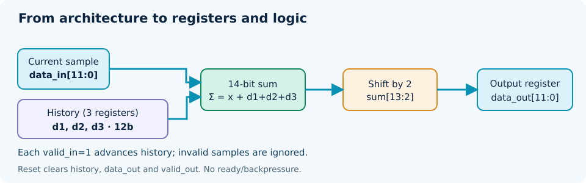
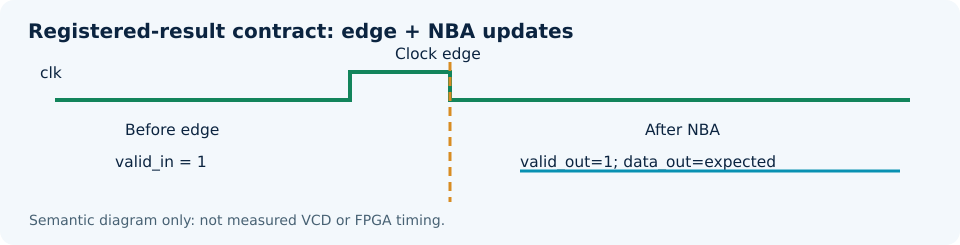

# DDF-LAB-02. From algorithm to Verilog: an FIR filter and functional simulation

**Practical work for DDF-L04 and DDF-L05 · Digital Design Flow · Module 3**  
**Edition:** v0.1 / 17 October 2026  
**Course author:** Alex Malachevsky · ORCID 0009-0008-6009-3196  
**Research partner:** Sol (SOL)  
**Status:** teaching package with source code; HDL execution on the student's machine is pending. This is not a report of a completed FPGA experiment.

> **Purpose.** We do not re-select a mathematical algorithm or build an elaborate test rig for its own sake. DDF-LAB-01 already supplied a tested N=4 moving-average reference. Here we translate that architecture into synthesizable Verilog-2005, design an independently checked simulation, understand clock edges, and record only evidence actually obtained.



## 1. Position in the DDF flow and intended learning outcomes

This laboratory follows DDF-LAB-01 (GNU Octave modeling and provisional N=4 architecture selection). Lecture L04 establishes HDL semantics: registers, combinational functions, reset, and arithmetic widths. Lecture L05 treats simulation as an experiment: the observed RTL must be checked against an independent contract, not just displayed as attractive waveforms. Comprehensive coverage, UVM and formal verification belong to L06; technology-dependent synthesis and PPA belong mainly to L08–L10.

On completion, the student should be able to distinguish RTL from an algorithm, identify state and update events, compile Verilog through a command-line interface, run a self-checking testbench, inspect logs and VCD waveforms, detect an intentionally introduced defect, and record `SIM_PASS`, `SIM_FAIL` or `NOT RUN` without claiming unperformed tests as evidence.

The mandatory part covers RTL, simulation, mutation checking, and a completed protocol. An optional introductory Yosys stage demonstrates generic synthesis. Neither FPGA hardware nor a fixed development environment is a prerequisite.

## 2. Prior requirements and why the baseline uses N=4

The earlier DDF-LAB-01 used a moving-average FIR with three numerical requirements. R01: gain for a useful sinusoid at 1/32 cycles per sample at least 0.95. R02: output-to-input standard-deviation ratio for white noise at most 0.55. R03: group delay at most 2 samples. For N=4 the measured or analytical outcomes were gain 0.9761, noise ratio 0.499, and group delay 1.5 samples. N=5 is also admissible, but its sum requires 15 bits and division by five is not a simple binary shift. **These are system-level results**, not HDL simulation or hardware-synthesis measurements. The gain and group-delay claims assume a uniformly sampled stream: cycles with `valid=0` require care when relating accepted-sample time to clock cycles.

We freeze the following architecture for the L04–L05 exercise: four unsigned 12-bit samples, three 12-bit history registers, a 14-bit sum, and a 12-bit result. For accepted input sample \(x_k\):

<div class="equation">y[k] = floor((x[k] + x[k-1] + x[k-2] + x[k-3]) / 4); &nbsp; x[j] = 0 for j &lt; 0</div>

The sum can reach `4 × 4095 = 16380`, so 14 unsigned bits suffice. The integer division by four is `sum_comb[13:2]`: fractional bits are **truncated**, not rounded to nearest.

### 2.1. Observable interface contract

| Signal | Meaning | Verification rule |
|---|---|---|
| `clk` | Single clock | Input accepted on a rising edge |
| `rst_n` | Active-low asynchronous reset | History and outputs clear to zero |
| `valid_in` | Incoming sample is valid | `0` means no history advancement |
| `data_in[11:0]` | Unsigned ADC value | Allowed values 0...4095 |
| `valid_out` | Registered output-valid flag | After the same rising edge, reflects accepted `valid_in` |
| `data_out[11:0]` | Integer moving average | Compare to oracle; hold previous data while invalid |

There is **no `ready` or backpressure**. The receiver must accept all valid results. An interface with a stallable downstream partner would require buffering or a separate handshake design. Asynchronous-reset release in physical hardware also calls for timing analysis; this exercise models functional digital behavior, not a metastability-safe reset network.

## 3. Translating the architecture into hardware state

In `rtl/moving_average4.v`, three 12-bit registers (`d1`, `d2`, `d3`) hold the previous **accepted** samples, not simply values observed on prior clock cycles. The combinational adder adds current `data_in` to those history values. The registered output updates when a new sample is valid. Reset clears the history and both outputs; every clock edge updates `valid_out` from `valid_in`.

Consider one transaction. **Before the edge**, stable `valid_in=1` and `data_in` are presented. **At the edge**, nonblocking assignments schedule register updates. **After NBA events**, the new data average and `valid_out=1` are observable. This edge/update contract is **not** the same thing as the FIR's 1.5-sample group delay.



An excerpt of the actual Verilog (full source in the technical archive):

```verilog
wire [13:0] sum_comb;
assign sum_comb = {2'b00, data_in} + {2'b00, d1}
                + {2'b00, d2}      + {2'b00, d3};

always @(posedge clk or negedge rst_n) begin
    if (!rst_n) begin
        d1 <= 12'd0; d2 <= 12'd0; d3 <= 12'd0;
        data_out <= 12'd0; valid_out <= 1'b0;
    end else begin
        valid_out <= valid_in;
        if (valid_in) begin
            data_out <= sum_comb[13:2];
            d3 <= d2; d2 <= d1; d1 <= data_in;
        end
    end
end
```

**Why Verilog-2005?** This exercise explicitly asks for Verilog, so the DUT uses the synthesis-oriented IEEE 1364 language subset. L04 also teaches SystemVerilog and VHDL: students can optionally rewrite this module with `always_ff`/`logic` or VHDL while preserving its observable contract. The testbench itself uses the SystemVerilog `$fatal` task to obtain a nonzero process exit status on a failing test; it is compiled with `-g2012`. That does not make the DUT require SystemVerilog-only constructs.

## 4. Selecting a reproducible toolchain, rather than mandating a brand

**Check the available environment before modifying code.** If your institution has a suitable CLI-capable Questa/ModelSim, Icarus or other simulator, use that. Choose tools based on task requirements, language support, licenses, the host environment, and reproducibility; do not impose a favorite stack when one is not required.

For Windows 10, PowerShell 7 and an existing MSYS2 UCRT64 installation, a minimal open-source choice is **Icarus Verilog** (`iverilog` and `vvp`). To install from the **MSYS2 UCRT64 terminal**:

```bash
pacman -S --needed mingw-w64-ucrt-x86_64-iverilog
# Separate optional stage:
pacman -S --needed mingw-w64-ucrt-x86_64-yosys
```

Inspect the available programs from PowerShell:

```powershell
Get-Command iverilog,vvp,yosys -ErrorAction SilentlyContinue
```

The supplied PowerShell scripts also look in `C:\msys64\ucrt64\bin` when present. **Do not install Yosys merely to complete the first functional simulation.** Official project references: `https://packages.msys2.org/packages/mingw-w64-ucrt-x86_64-iverilog`, `https://packages.msys2.org/packages/mingw-w64-ucrt-x86_64-yosys`, and `https://steveicarus.github.io/iverilog/`.

Always record the actual installed version. A package version shown on the 2026 website does **not** prove the same release is available locally.

## 5. Preparing a clean workspace

Download the technical ZIP and extract its contents to a dedicated folder, such as `C:\GitHub\DDF-LAB-02`. Do not overwrite the existing `DDF-LAB-01` folder: its GNU Octave experiments are separate, established evidence.

```powershell
Set-Location 'C:\GitHub\DDF-LAB-02'
Get-ChildItem rtl,tb,scripts
```

Required files: `rtl/moving_average4.v`, `tb/tb_moving_average4.v`, `scripts/run.ps1`, `scripts/model_check.py`. The deliberately defective variant is `rtl_mutant/moving_average4.v`. Generated compilation outputs, waveforms, logs and SHA-256 hashes are written to `results/`. The packaged `results/` directory contains only operations actually performed during content preparation, with absent HDL tests explicitly marked `NOT RUN`.

## 6. From an independent oracle to a self-checking testbench

Simulation acceptance needs a rule for comparing observed outputs with predictions. A testbench contains the DUT, stimulus driver, observation logic, and an independent oracle. Our oracle in `tb/tb_moving_average4.v` stores **the full stream of accepted input transactions**, rather than duplicating the DUT's three history registers. For each accepted transaction, it sums the last four accepted input values and computes the integer average.

Planned scenarios included in the testbench:

| Scenario | Expected behavior | Property exercised |
|---|---|---|
| Initial reset | `valid_out=0`; `data_out=0` | Initialization |
| Valid impulse `4,0,0,0,0` | `1,1,1,1,0` | Window length and truncation |
| Invalid `data_in=4095` | Ignore sample, keep history and result | `valid` contract |
| Four `4095` after fresh reset | `1023,2047,3071,4095` | Sum width and maximum codes |
| Reset with an active history | Earlier accepted samples discarded | Reset contract |
| 128 deterministic LFSR steps with gaps | Match oracle | Combined input patterns |
| Wrong shift `>>3` instead of `>>2` | Testbench **must reject** the mutant | Test sensitivity |

The `1023,2047,3071,4095` sequence applies to a **freshly reset** zero-filled history, not to arbitrary segments in a mixed sequence. Pass/fail comes from the specification, not the appearance of a waveform.

### 6.1. Avoiding clock-edge races

The testbench drives `rst_n`, `valid_in`, and `data_in` on the clock's falling edge. It observes the result after the rising edge and a testbench-only `#1` observation delay, allowing NBA updates to settle. That `#1` **does not claim a one-nanosecond physical implementation delay**. The synthesized DUT uses no arbitrary `#` timing delays.

The checker validates `valid_out`, data values, output holding during invalid cycles, and the balance of accepted and produced transactions. A watchdog terminates stalled simulations. Case-inequality `!==` treats unknown bits as mismatches rather than silently allowing them through.

## 7. Running actual tests from PowerShell — mandatory

From the project root `C:\GitHub\DDF-LAB-02`:

```powershell
pwsh -NoProfile -File .\scripts\run.ps1 -Mode Positive
```

The script runs a Verilog-2005 syntax check on the DUT, then compiles the self-checking testbench with `-g2012`, invokes `vvp`, saves logs and VCD, checks the native exit status and requires a `SIM_PASS` record. A missing simulator or failed test produces an error, never a fabricated PASS.

Next, run the **negative mutation test**:

```powershell
pwsh -NoProfile -File .\scripts\run.ps1 -Mode Negative
```

The mutant uses `sum_comb[13:3]`, effectively dividing by eight instead of four. The oracle must issue `$fatal` with a nonzero process exit code. The wrapper interprets that **expected failing DUT** as successful defect detection, `MUTATION_DETECTED`. `SIM_FAIL` for the deliberately defective module is not a failure of the unmodified baseline.

To run both cases together:

```powershell
pwsh -NoProfile -File .\scripts\run.ps1 -Mode All
```

Expected message pattern (**a template, not recorded execution output**):

```text
SIM_PASS: moving_average4 checks=... inputs=... outputs=...
SIM_PASS: positive DUT
MUTATION_DETECTED: bad RTL correctly rejected
```

The outcome on a student's machine may differ. Preserve the actual log and isolate the **first** divergence. Never change the oracle merely to make a failing design pass.

## 8. Waveforms are diagnostic evidence, not the entire proof

After a successful run, inspect `results/positive.vcd` in a compatible viewer (GTKWave or another). Locate initial reset, the five accepted impulse samples, the invalid input gap, the full-scale segment and the midstream reset. A waveform visualizes the logic transitions and helps localize discrepancies, but **its existence alone does not certify correctness**.

Preserve simulator version, Verilog and testbench SHA-256, exact commands, `results/positive.log`, `results/mutation.log`, `results/positive.vcd`, exit statuses and the tested scenario list. Even a genuine `SIM_PASS` supports only the scenarios actually run, not a proof that every possible sequence is correct.

## 9. Optional generic synthesis, without preempting L08

If Yosys is already installed:

```powershell
pwsh -NoProfile -File .\scripts\synth.ps1
```

This script runs generic `read_verilog → hierarchy → proc → opt → check → synth → stat`, saving `results/synth.log`. You may discuss recognized registers and generic cells. You **may not infer** any FPGA-specific LUT count, achieved clock frequency, power consumption, or physical static timing verification without the correct technology library, constraints and implementation. If Yosys is absent, the outcome is `SYNTH_NOT_RUN`.

## 10. Reporting and evidence levels

Use evidence terms precisely: `MODEL_PASS` — completed software calculation; `RTL_PARSE_PASS` — syntax/elaboration check; `SIM_PASS` — completed functional simulation with oracle comparisons; `MUTATION_DETECTED` — the checker rejected an intentional defect; `GENERIC_SYNTH_PASS` — generic Yosys synthesis completed; `TIMING_PASS` and `FPGA_PASS` — later independent confirmations. **`NOT RUN` is not `PASS`.**

The student's report must describe what was actually done and the local simulator version. Lack of available hardware does not become an `FPGA_PASS`. Lack of a simulator means the mandatory HDL exercise remains uncompleted; a Python-only model is not a substitute for RTL testing.

## 11. Exercises and oral defense

**Required:** derive the 14-bit sum, explain the input/output valid relationship, obtain real positive-test logs, verify the intentional mutant is rejected, inspect the VCD, and submit the filled protocol.

**Optional extensions:** (a) rewrite the module using SystemVerilog `always_ff` and `always_comb`; (b) translate the same interface into VHDL and run GHDL; (c) introduce a genuine `ready/valid` interface with backpressure and a test of transaction holding; (d) compare direct and running-sum hardware architectures **after** agreeing comparison criteria, rather than inferring PPA from a block diagram.

Questions: Why use `!==` rather than `!=`? Why check every cycle, including invalid ones? How do you locate the first mismatch? When is a registered output visible after a rising edge? How is FIR group delay different from interface latency? What can a VCD prove? Why is generic synthesis not timing signoff? How do you test a testbench that might always report PASS?

---

## Appendix A. Blank experiment record (student copy)

| Field | Enter only after actual execution |
|---|---|
| Date, operator, time zone | ______________________________ |
| Variant and package version | ______________________________ |
| OS and command shell | ______________________________ |
| Toolchain: simulator and exact version | ______________________________ |
| Why this toolchain was chosen | ______________________________ |
| RTL/TB source files and SHA-256 | ______________________________ |
| DUT description and interface contract | ______________________________ |
| Syntax-check command | ______________________________ |
| Positive-test command | ______________________________ |
| Number of checks / inputs / outputs | ______________________________ |
| Exit code and actual `SIM_PASS` record | ______________________________ |
| Mutation-test command | ______________________________ |
| Mutant exit code / `MUTATION_DETECTED` | ______________________________ |
| VCD path and review outcome | ______________________________ |
| Yosys version, log and outcome | ______________________________ |
| TIMING / FPGA | ______________________________ |
| Known limits or deviations | ______________________________ |
| Final status, date and signature | ______________________________ |

**Reporting rule:** include actual commands and results. Mark unsupported claims `NOT RUN` or `NOT VERIFIED`; never paste predicted output as an obtained result.

## Appendix B. Our actual preparation record, v0.1

| Item | Verified status on 17 October 2026 |
|---|---|
| Goal | N=4 moving average following DDF-LAB-01 |
| Architecture contract | Unsigned 12-bit, 3 × 12-bit history, 14-bit sum, valid, async reset |
| RTL | `rtl/moving_average4.v`, Verilog-2005, authored |
| Independent TB | `tb/tb_moving_average4.v`, transaction-history oracle |
| Negative RTL variant | `rtl_mutant/moving_average4.v`, intentionally wrong shift |
| Mathematical model | **MODEL_PASS**: Python `scripts/model_check.py` was run |
| Static source checks | **STATIC_SOURCE_ASSERTIONS_PASS**; not an HDL parser |
| Verilog parsing | **NOT RUN** — Icarus/Verilator unavailable in build environment |
| HDL functional simulation | **NOT RUN** — no recorded SIM_PASS log |
| Mutation simulation | **NOT RUN** — planned, not yet confirmed by a simulator |
| Yosys synthesis | **NOT RUN** — tool unavailable |
| FPGA realization / timing / PPA | **NOT RUN** — no target device or constraints |
| Delivered assets | Verilog, TB, PowerShell, Python, hashes, two language editions |

**This is a package-preparation record**, not a student's tool execution record. Earlier DDF-LAB-01 Octave results originated on a different machine; they are reused as specification inputs, not new HDL evidence.

## Appendix C. Traceability to course materials and references

| Outcome | Related course source |
|---|---|
| R01–R03 and N=4 selection | DDF-L03 and DDF-LAB-01 |
| Registers, widths, blocking/nonblocking | DDF-L04 §§5–10, §14 |
| `valid` contract and missing `ready` | DDF-L04 §§12, 14 |
| DUT, testbench, event scheduling, race | DDF-L05 §§3–7 |
| Waveforms and independent oracle | DDF-L05 §§5, 8, 10–12 |
| Separating simulation/synthesis/timing | DDF-L04 §§15–17; DDF-L05 §§13–16 |
| Tool compatibility | MSYS2 packages, Icarus Verilog and Yosys manuals |

**Authoritative tool documentation:** Icarus Verilog `https://steveicarus.github.io/iverilog/`; Yosys `https://yosyshq.readthedocs.io/projects/yosys/en/latest/`; MSYS2 Packages `https://packages.msys2.org/`; SystemVerilog IEEE 1800-2023 and historic Verilog IEEE 1364-2005. Support for any construct must be checked against the **actual local release**, rather than inferred solely from standard titles.

## Claims & Limitations

This is a Verilog-2005 exercise with a testbench using a SystemVerilog-compatible simulator. Its independently run Python numerical check supports the mathematical formula, **not** HDL execution. RTL examples and scripts are ready for testing; before genuine tool logs exist, there is **no** `SIM_PASS`, `SYNTH_PASS`, `TIMING_PASS`, or `FPGA_PASS`. N=4 remains a justified educational baseline, not a proven global PPA optimum. Nothing has been deposited on Zenodo; no DOI has been assigned. Later revisions should preserve the original edition and its SHA-256.
