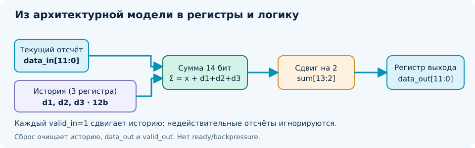
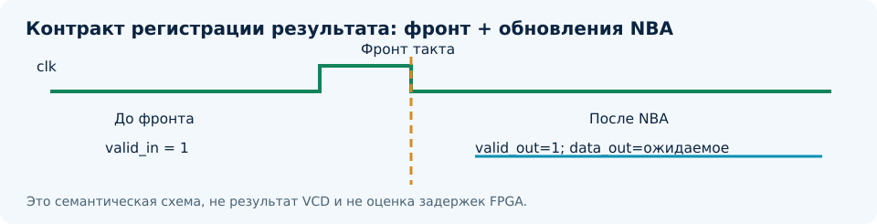

# DDF-LAB-02. От алгоритма к Verilog: цифровой FIR-фильтр и функциональная симуляция

**Практикум к DDF-L04 и DDF-L05 · Digital Design Flow · Модуль 3**  
**Редакция:** v0.1 / 17 октября 2026 года  
**Автор учебного курса:** Алексей Малачевский (Alex Malachevsky) · ORCID 0009-0008-6009-3196  
**Исследовательский партнёр:** Сол (SOL)  
**Статус:** методический комплект с исходниками; фактический запуск HDL на компьютере учащегося ожидается. Не является отчётом о FPGA-испытании.

> **Смысл практикума.** Мы не выбираем математическую функцию заново и не создаём сложный стенд ради него самого. DDF-LAB-01 уже дал эталон фильтра N=4. Здесь превращаем принятую архитектуру в аппаратное описание на Verilog-2005, пишем независимую проверку, изучаем фронты такта и фиксируем ровно те свидетельства, которые реально получили.



## 1. Место работы в маршруте DDF и результаты обучения

Эта работа продолжает практикум DDF-LAB-01 (GNU Octave, архитектурный выбор N=4). Лекция L04 определяет семантику языка HDL: регистры, комбинационные операции, reset и ширины данных. Лекция L05 требует не просто «красивой осциллограммы», а независимого тестбенча, проверяющего контракт устройства. Глубокое coverage, UVM и формальные методы — предмет L06; технологический синтез и PPA — L08–L10.

К концу практикума учащийся должен уметь отличать RTL от вычислительного алгоритма; указывать хранение состояния и момент его обновления; компилировать Verilog из CLI; запускать самопроверяющий тест; читать журнал и VCD; обнаруживать умышленно внесённую ошибку; составлять протокол `SIM_PASS`, `SIM_FAIL` или `NOT RUN` без присвоения несостоявшихся результатов.

Работа состоит из обязательной части (RTL + симуляция + протокол) и необязательного ознакомительного синтеза Yosys. Физическая FPGA не требуется; микросхему, плату и распиновку заранее не навязываем.

## 2. Исходные требования и обоснование выбора N=4

В DDF-LAB-01 рассматривался фильтр скользящего среднего. Были заданы R01: коэффициент передачи полезной синусоидальной компоненты частотой 1/32 отсчёта не менее 0,95; R02: отношение стандартных отклонений выходного и входного белого шума не более 0,55; R03: групповая задержка не более 2 отсчётов. Для N=4 получены соответственно 0,9761; 0,499; 1,5 отсчёта. N=5 тоже допустим, но потребует 15-битной суммы и деления на пять. **Это свидетельства системного уровня**, их нельзя автоматически считать результатом RTL-симуляции или синтеза. Значения усиления и групповой задержки относятся к равномерно дискретизированному потоку; пропуски `valid` следует интерпретировать в шкале принятых отсчётов, а не механически в тактах.

В лабораторной L04–L05 фиксируем базовую реализацию: четыре беззнаковых 12-битных отсчёта, три регистра истории, 14-битное суммирование, 12-битный результат. Для принятого входного отсчёта \(x_k\):

<div class="equation">y[k] = floor((x[k] + x[k-1] + x[k-2] + x[k-3]) / 4); &nbsp; x[j] = 0 for j &lt; 0</div>

Максимальная сумма `4 × 4095 = 16380`, поэтому хватит 14 бит. Целочисленное деление на 4 реализуется выбором битов `sum_comb[13:2]`. Дробная часть **отбрасывается**, а не округляется до ближайшего целого.

### 2.1. Контракт интерфейса, который должен знать тестбенч

| Сигнал | Назначение | Правило проверки |
|---|---|---|
| `clk` | Единственный такт | Вход принимается на положительном фронте |
| `rst_n` | Активный низкий асинхронный сброс | История и выходы переходят в ноль |
| `valid_in` | Признак действительного отсчёта | При 0 история не продвигается |
| `data_in[11:0]` | Данные АЦП (unsigned) | Значения 0...4095 |
| `valid_out` | Зарегистрированная действительность выхода | После того же фронта соответствует принятому `valid_in` |
| `data_out[11:0]` | Целочисленное среднее | Сравнивать с эталоном; при `valid_in=0` удерживать прежнее значение |

Это **интерфейс без `ready` и backpressure**. Приёмник обязан принимать каждый `valid_out=1`. Нельзя подключать его к останавливаемому потребителю, не добавив отдельную буферизацию или протокол. Снятие асинхронного reset в физической схеме требует отдельного анализа тактирования; лабораторная демонстрирует цифровую модель, а не защищённый от метастабильности reset-tree.

## 3. Конструктивная схема: состояние, логика, выход

В исходном файле `rtl/moving_average4.v` три 12-битных регистра `d1`, `d2`, `d3` хранят последние **принятые**, а не последние календарные такты. Комбинаторная сеть суммирует текущий `data_in` с регистрами; регистр выхода обновляется только если действителен новый отсчёт. Асинхронный сброс обнуляет историю, `valid_out` и `data_out`. У `valid_out` на каждом фронте записывается текущий `valid_in`.

Выполните мысленно один такт: **до фронта** на входе выставлены `valid_in=1` и отсчёт. **Во фронте** регистры планируют новые значения (nonblocking assignments). **После обновлений NBA** можно наблюдать выходное среднее и `valid_out=1`. Это **не** та же величина, что групповая задержка FIR 1,5 отсчёта.



Базовая идея RTL (полный исходник находится в архиве):

```verilog
wire [13:0] sum_comb;
assign sum_comb = {2'b00, data_in} + {2'b00, d1}
                + {2'b00, d2}      + {2'b00, d3};

always @(posedge clk or negedge rst_n) begin
    if (!rst_n) begin
        d1 <= 12'd0; d2 <= 12'd0; d3 <= 12'd0;
        data_out <= 12'd0; valid_out <= 1'b0;
    end else begin
        valid_out <= valid_in;
        if (valid_in) begin
            data_out <= sum_comb[13:2];
            d3 <= d2; d2 <= d1; d1 <= data_in;
        end
    end
end
```

**Почему Verilog-2005?** Формулировка практикума требует Verilog, поэтому аппаратный блок написан на поддерживаемом подмножестве IEEE 1364. L04 также изучает SystemVerilog и VHDL: желающий может самостоятельно перевести модуль на `always_ff` и `logic` или VHDL, сохранив контракт и тесты. Тестбенч использует `$fatal` из SystemVerilog для ненулевого кода возврата при ошибке; компиляция теста выполняется с `-g2012`. Это не превращает DUT в SystemVerilog-зависимую архитектуру.

## 4. Подбор инструментария: минимальный воспроизводимый маршрут

**Прежде чем писать или править код, проверьте рабочее окружение.** Если в учебной организации уже имеется совместимый Icarus, Questa/ModelSim или другой HDL-симулятор с CLI, можно использовать его. Жёстко закреплять единственный стек нет оснований: оцениваются функциональность, совместимость с синтаксисом, условия лицензирования, воспроизводимость и цена подготовки.

Для типичного Windows 10 + PowerShell 7 + ранее установленного MSYS2 UCRT64 выбран небольшой открытый инструмент **Icarus Verilog** (`iverilog` + `vvp`). Схема рекомендуемой установки в терминале **MSYS2 UCRT64**:

```bash
pacman -S --needed mingw-w64-ucrt-x86_64-iverilog
# Необязательный следующий этап:
pacman -S --needed mingw-w64-ucrt-x86_64-yosys
```

Проверить наличие в PowerShell 7 можно одной командой:

```powershell
Get-Command iverilog,vvp,yosys -ErrorAction SilentlyContinue
```

Сценарии практикума также пытаются найти инструменты в `C:\msys64\ucrt64\bin`, если MSYS2 установлен в стандартный каталог. **Не устанавливайте Yosys только ради выполнения первой симуляции**: это отдельный необязательный этап. Официальные пакеты и документация: `https://packages.msys2.org/packages/mingw-w64-ucrt-x86_64-iverilog`, `https://packages.msys2.org/packages/mingw-w64-ucrt-x86_64-yosys`, `https://steveicarus.github.io/iverilog/`.

Проверка должна фиксировать фактические версии. Страница пакета 2026 года **не является утверждением**, что именно эта версия уже установлена на конкретном компьютере.

## 5. Подготовка рабочей папки

Скачайте технический ZIP и распакуйте его содержимое в отдельную папку, например `C:\GitHub\DDF-LAB-02`. Не смешивайте его с существующим каталогом `DDF-LAB-01` — тот содержит проверенную математическую модель и результаты Octave.

В PowerShell:

```powershell
Set-Location 'C:\GitHub\DDF-LAB-02'
Get-ChildItem rtl,tb,scripts
```

Обязательные исходники: `rtl/moving_average4.v`, `tb/tb_moving_average4.v`, `scripts/run.ps1`, `scripts/model_check.py`; специальная дефектная копия — `rtl_mutant/moving_average4.v`. Выходные `.vvp`, `.vcd`, журналы и контрольные суммы будут сохранены в `results/`. В архиве `results/` содержатся только результаты, действительно полученные в среде подготовки, и явно обозначенные `NOT RUN`.

## 6. От программного эталона к независимому тестбенчу

Приёмка начинается не с появления прямоугольных импульсов на экране, а с формально зафиксированного правила сравнения. У тестбенча есть DUT, генератор стимулов, наблюдатель выхода и независимый *oracle*. Эталон `tb/tb_moving_average4.v` хранит **всю последовательность принятых входных транзакций**, а не дублирует три регистра DUT. Для k-й принятой транзакции он суммирует четыре последних действительных значения и делит целочисленно на четыре.

Разметка сценариев (предусмотрены в готовом TB):

| Испытание | Ожидаемое поведение | Что проверяется |
|---|---|---|
| Сброс до старта | `valid_out=0`, `data_out=0` | Инициализация |
| Импульс `4,0,0,0,0` | `1,1,1,1,0` на пяти действительных отсчётах | Длина окна и усечение |
| `valid_in=0` при `data_in=4095` | Игнорировать вход, сохранить историю и данные выхода | Контракт `valid` |
| Четыре `4095` после нового сброса | `1023,2047,3071,4095` | 14-битная сумма, граничный код |
| Сброс посреди потока | Старые отсчёты исключены | Reset контракта |
| 128 шагов LFSR с пропусками | Совпадение с транзакционным эталоном | Комбинации входов |
| Дефектная копия `>>3` вместо `>>2` | Тест **обязан обнаружить ошибку** | Чувствительность тестбенча |

Указанная последовательность `1023,2047,3071,4095` относится к **чистому окну после нового reset**, а не к любому месту смешанного теста. Критерием является контракт, а не удобная форма графика.

### 6.1. Как исключаем гонку на фронте

Тестбенч меняет `rst_n`, `valid_in` и `data_in` по отрицательному фронту `clk`, а результат считывает после положительного фронта и тестовой задержки `#1`. Задержка `#1` допустима в несинтезируемом TB для наблюдения после NBA. **Она не задаёт физическую задержку устройства.** В `rtl/moving_average4.v` нет ни `#1`, ни `#10`.

Проверяем не только численный `data_out`, но и `valid_out`, удержание выхода при недействительном входе и баланс входных/выходных транзакций. TB имеет тайм-аут. Неизвестные биты считаются ошибкой: при сравнении применяется `!==`, а не `!=`.

## 7. Реальный запуск в PowerShell — обязательная часть

Из корня `C:\GitHub\DDF-LAB-02`:

```powershell
pwsh -NoProfile -File .\scripts\run.ps1 -Mode Positive
```

Сценарий последовательно выполняет Verilog-2005 синтаксическую проверку RTL и компиляцию testbench в режиме `-g2012`, запускает `vvp`, сохраняет журнал и VCD, проверяет **код возврата** и наличие `SIM_PASS`. Если программа не найдена или тест не пройден, сценарий завершится ошибкой — отсутствие запуска не выдаётся за `PASS`.

После этого выполните отрицательный тест:

```powershell
pwsh -NoProfile -File .\scripts\run.ps1 -Mode Negative
```

В мутанте выход вычисляется как `sum_comb[13:3]`: то есть ошибка деления на восемь вместо четырёх. Тестбенч должен вызвать `$fatal` и вернуть **ненулевой** exit code. Управляющий сценарий признаёт именно такой результат успешным обнаружением ошибки: `MUTATION_DETECTED`. **`SIM_FAIL` дефектной копии — ожидаемый результат негативного испытания, а не провал основного DUT.**

Для обоих испытаний одной командой:

```powershell
pwsh -NoProfile -File .\scripts\run.ps1 -Mode All
```

Ожидаемые сообщения (это **шаблон**, а не зафиксированный вывод):

```text
SIM_PASS: moving_average4 checks=... inputs=... outputs=...
SIM_PASS: positive DUT
MUTATION_DETECTED: bad RTL correctly rejected
```

**Обратите внимание:** итог может оказаться другим. В таком случае важно сохранить фактический лог и первую причину расхождения. Не правьте ожидаемые результаты только ради получения `PASS`.

## 8. От осциллограммы к доказательству

После запуска проверьте `results/positive.vcd` в любом совместимом просмотрщике (GTKWave или другом). Найдите начальный reset, пять действительных отсчётов импульса, пропуск `valid_in=0`, участок `4095` и повторный reset. Осциллограмма позволяет локализовать расхождения по сигналам, но **сама по себе не подтверждает правильность данных**.

Сохраняйте комплект: имя симулятора и версия, входные RTL и TB с SHA-256, фактические команды, `results/positive.log`, `results/mutation.log`, `results/positive.vcd`, exit codes и перечень проверенных сценариев. Результат с явным `SIM_PASS` подтверждает **только выполненные функциональные испытания**, не отсутствие всех возможных ошибок.

## 9. Дополнительный ознакомительный синтез — не подменять L08

Если Yosys уже установлен, можно выполнить:

```powershell
pwsh -NoProfile -File .\scripts\synth.ps1
```

Скрипт проверяет доступность Yosys и выполняет generic synthesis `read_verilog → hierarchy → proc → opt → check → synth → stat`, сохраняя `results/synth.log`. На этом этапе допустимо обсуждать, какие регистры и логические ресурсы распознал инструмент. **Нельзя** делать выводы о максимальной частоте, LUT конкретной FPGA, мощности или физическом STA без технологической реализации и ограничений. Отсутствие Yosys даёт `SYNTH_NOT_RUN`.

## 10. Как оформлять инженерный протокол

Минимальный набор статусов: `MODEL_PASS` — выполненный программный расчёт; `RTL_PARSE_PASS` — синтаксис/элаборация; `SIM_PASS` — выполненная функциональная симуляция с проверкой; `MUTATION_DETECTED` — отрицательный тест отловил дефект; `GENERIC_SYNTH_PASS` — базовый синтез Yosys; `TIMING_PASS`, `FPGA_PASS` — отдельные дальнейшие подтверждения. **`NOT RUN` не равен `PASS`.**

Отчёт должен воспроизводить полученный опыт, а не безадресно копировать прогнозируемые строки. Студент указывает собственный toolchain и точные версии. Если оборудование отсутствует, проект не объявляется аппаратно проверенным. Если симулятор отсутствует, обязательная задача ещё не выполнена, а не заменена Python-моделью.

## 11. Учебные задания и вопросы на защиту

**Обязательно:** объясните, почему для фильтра N=4 достаточно 14 бит; покажите связь входного `valid_in` и зарегистрированного `valid_out`; получите фактический журнал положительного теста; убедитесь, что негативная мутация обнаружена; просмотрите VCD и сохраните заполненный протокол.

**Дополнительно по выбору:** (а) реализуйте вариант на SystemVerilog с `always_ff` и `always_comb`; (б) реализуйте тот же контракт на VHDL и проверьте GHDL; (в) добавьте `ready/valid` с настоящим backpressure и проверкой удержания транзакции; (г) сравните прямую и рекурсивную аппаратные архитектуры **после** определения критерия сравнения, не подменяя синтез предположениями.

Вопросы для защиты: зачем `!==` вместо `!=`? Почему тест проверяет каждый такт, включая invalid? Как найти «первое расхождение»? В какой момент доступен выход после фронта? Чем group delay отличается от interface latency? Что доказывает VCD? Почему `SYNTH_PASS` не означает `TIMING_PASS`? Как обнаружить тестбенч, который всегда пишет PASS?

---

## Приложение A. Чистый протокол испытаний (для учащегося)

| Поле | Заполнить после реального выполнения |
|---|---|
| Дата, исполнитель, часовой пояс | ______________________________ |
| Вариант и версия пакета | ______________________________ |
| ОС и shell | ______________________________ |
| Toolchain: симулятор и полная версия | ______________________________ |
| Почему выбран этот toolchain | ______________________________ |
| Источники RTL и TB / SHA-256 | ______________________________ |
| Описание DUT и контракт интерфейса | ______________________________ |
| Команда синтаксической проверки | ______________________________ |
| Команда положительного испытания | ______________________________ |
| Число проверок / входов / выходов | ______________________________ |
| Код возврата / строка `SIM_PASS` | ______________________________ |
| Команда отрицательного испытания | ______________________________ |
| Код возврата мутанта / `MUTATION_DETECTED` | ______________________________ |
| VCD: путь и факт просмотра | ______________________________ |
| Yosys: версия, журнал, результат | ______________________________ |
| TIMING / FPGA | ______________________________ |
| Известные ограничения / отклонения | ______________________________ |
| Итоговый статус, дата, подпись | ______________________________ |

**Правило заполнения:** приводить только фактические команды и результаты. При отсутствии свидетельства ставить `NOT RUN` или `NOT VERIFIED`; не вписывать ожидаемые строки как полученные.

## Приложение B. Протокол нашей подготовки, версия v0.1

| Позиция | Достоверное состояние на 17.10.2026 |
|---|---|
| Назначение | Учебный фильтр N=4 как продолжение DDF-LAB-01 |
| Архитектурный контракт | 12-bit unsigned; 3 × 12-bit history; 14-bit sum; valid; async reset |
| RTL | `rtl/moving_average4.v`, Verilog-2005, подготовлен |
| Независимый тестбенч | `tb/tb_moving_average4.v`, проверяет транзакционную историю |
| Отрицательный экземпляр | `rtl_mutant/moving_average4.v`, ошибочный сдвиг |
| Математическая модель | **MODEL_PASS**: Python `scripts/model_check.py` выполнен в среде подготовки |
| Статические проверки исходников | **STATIC_SOURCE_ASSERTIONS_PASS**, не HDL-парсер |
| HDL RTL parsing | **NOT RUN** — Icarus/Verilator недоступны в среде подготовки |
| Функциональная HDL-симуляция | **NOT RUN** — лог SIM_PASS отсутствует |
| Негативная HDL-мутация | **NOT RUN** — ожидаемое обнаружение, ещё не подтверждено симулятором |
| Синтез Yosys | **NOT RUN** — инструмент отсутствует |
| Реализация FPGA / timing / PPA | **NOT RUN** — платформа и ограничения не заданы |
| Программные артефакты | Исходники Verilog, TB, PowerShell и Python, контрольные суммы, две языковые редакции |

**Оговорка:** это **протокол подготовки методического комплекта**, а не протокол прогона на компьютере учащегося. Вычислительные данные DDF-LAB-01 ранее были получены в Octave в другой среде; здесь они используются как исходная спецификация, а не как новое HDL-свидетельство.

## Приложение C. Карта соответствия лекциям и источники

| Результат | Связанный материал |
|---|---|
| R01–R03, выбор N=4 | DDF-L03 и DDF-LAB-01 |
| Регистры, ширины, blocking/nonblocking | DDF-L04 §5–10, §14 |
| Контракт `valid`, отсутствие `ready` | DDF-L04 §12, §14 |
| DUT, TB, event scheduling и race | DDF-L05 §3–7 |
| Осциллограммы, независимый oracle | DDF-L05 §5, §8, §10–12 |
| Разграничение simulation/synthesis/timing | DDF-L04 §15–17; DDF-L05 §13–16 |
| Инструментальные зависимости | MSYS2 packages, Icarus Verilog and Yosys manuals |

**Официальная документация для сверки:** Icarus Verilog `https://steveicarus.github.io/iverilog/`; Yosys `https://yosyshq.readthedocs.io/projects/yosys/en/latest/`; MSYS2 Packages `https://packages.msys2.org/`; SystemVerilog IEEE 1800-2023, Verilog IEEE 1364-2005 (исторический языковой уровень). Поддержка конкретных конструкций и поведение симулятора определяются **проверенной локальной версией**, а не только названием стандарта.

## Claims & Limitations

Это практикум на Verilog-2005 с тестбенчем, совместимым с SystemVerilog-средствами моделирования. Python-эксперимент подтвердил математические формулы, но не исполнение HDL. Исходники готовы к инструментальному запуску; до сохранения фактических логов **нет** заявлений `SIM_PASS`, `SYNTH_PASS`, `TIMING_PASS` или `FPGA_PASS`. Архитектурный выбор N=4 остаётся учебным baseline, а не доказанным глобальным оптимумом PPA. Публикация на Zenodo не произведена и DOI не присвоен. История модификаций должна хранить отдельные версии и SHA-256.
